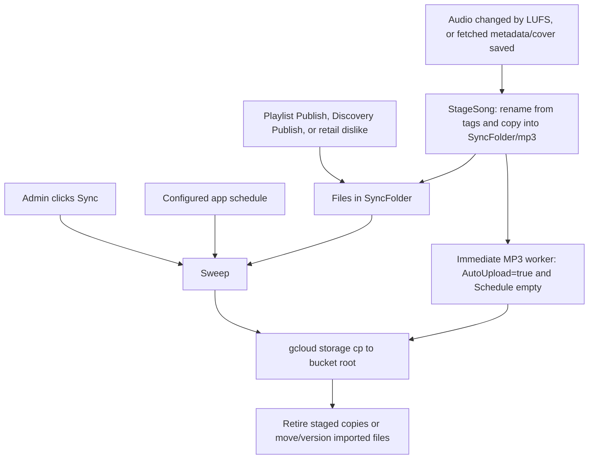

# GCP Sync service and Sync button

This reference describes the current implementation, reviewed on 11 October
2026. It includes the change that lets playlists publish independently when an
MP3 or another playlist fails. The shorter setup guide is
[gcp-sync-workflow.md](gcp-sync-workflow.md).

## Contents

- [Purpose and flow](#purpose-and-flow)
- [Setup and configuration](#setup-and-configuration)
- [Manual, immediate, and scheduled modes](#manual-immediate-and-scheduled-modes)
- [Sync button and HTTP endpoints](#sync-button-and-http-endpoints)
- [What creates pending files](#what-creates-pending-files)
- [Folders and file rules](#folders-and-file-rules)
- [Artist and Title naming](#artist-and-title-naming)
- [Staging, concurrent edits, and retries](#staging-concurrent-edits-and-retries)
- [Playlist publishing and versioning](#playlist-publishing-and-versioning)
- [Google Cloud commands](#google-cloud-commands)
- [Email notifications](#email-notifications)
- [Dry run](#dry-run)
- [Troubleshooting](#troubleshooting)
- [Current limitations](#current-limitations)
- [Implementation map and tests](#implementation-map-and-tests)

## Purpose and flow

The built-in `core/gcpsync` service publishes pending MP3s and M3U playlists to
a Google Cloud Storage bucket. It replaces the previous external
`sync-to-GCS` shell-script workflow. Transfers still use the installed `gcloud`
CLI; scheduling and file processing run inside Navidrome.

`SyncFolder` is the disk inbox for pending work. A **sweep** processes the inbox
recursively. A separate immediate-upload worker can process app-staged MP3 edits
when configured to do so.



The library already contains the updated audio before staging. Manual mode keeps
the bucket's previous copy until Sync runs. The service publishes file contents;
it does not restart playback devices or guarantee that an already-playing device
immediately reloads a changed object.

## Setup and configuration

For manual uploads, configure the following in `navidrome.toml`. These are example
paths and a placeholder bucket; replace them with your installation's values.

```toml
MusicFolder = '/srv/music'
SyncFolder = '/srv/sync'
PlaylistsPath = '/srv/playlists/**'
DeletedPlaylistsPath = '/srv/deleted-playlists'

[GCPSync]
Enabled = true
Bucket = 'your-existing-bucket'
GcloudPath = 'gcloud'
CredentialsFile = '/srv/secrets/gcp-service-account.json'
AutoUpload = false
Schedule = '0'
DryRun = false
LastVersionFolder = '/srv/playlist-versions'
```

The application account must be able to read the source files, write the staging
and destination directories, run `gcloud`, and list/create/overwrite objects in
the configured bucket. Uploads do not create a bucket. Configure and verify the
CLI's authentication for the same account and environment that run Navidrome.

### Folder settings

| Setting | Default | Use |
|---|---|---|
| `MusicFolder` | `./music` | Destination for imported MP3s; fallback library root for staging. |
| `SyncFolder` | Empty | Inbox; required for manual Sync and staging. |
| `PlaylistsPath` | Empty | Local playlist destination. Sync uses the first path-list entry and strips its trailing `**` and path separator. |
| `DeletedPlaylistsPath` | Empty | Destination for unsupported files; if empty, Sync uses `SyncFolder/trash`. |

On Linux, path-list entries use `:`; on Windows they use `;`. Relative paths
resolve against the application's working directory. Case matters on a
case-sensitive filesystem: `Sync` and `sync` must match the actual directory.

### Service settings

These defaults are defined in [configuration.go](../conf/configuration.go).

| Setting | Default | Use |
|---|---|---|
| `GCPSync.Enabled` | `false` | Enables the service. |
| `GCPSync.Bucket` | Empty | Bucket name without `gs://`; required. |
| `GCPSync.AutoUpload` | `false` | Enables automatic publishing according to `Schedule`. Manual Sync remains available. |
| `GCPSync.Schedule` | `'0'` | `'0'`: manual only; `''`: immediate app MP3 uploads; cron/interval: timed sweeps. |
| `GCPSync.GcloudPath` | `'gcloud'` | Executable name or absolute path to the CLI. |
| `GCPSync.CredentialsFile` | Empty | Passed to CLI processes as `GOOGLE_APPLICATION_CREDENTIALS`; see [Google Cloud commands](#google-cloud-commands). |
| `GCPSync.DryRun` | `false` | Logs proposed uploads and moves instead of making them. |
| `GCPSync.LastVersionFolder` | Empty | Local playlist archive directory. Set this and `PlaylistsPath` to clear successfully processed playlists from Sync. |
| `GCPSync.EnforceNaming` | `true` | Legacy compatibility setting. It does not bypass embedded Artist/Title requirements or control upload eligibility. |

When `Enabled` is false or the bucket is empty, `StageSong` and `StageMP3` do not
stage edits. Local LUFS/metadata operations can still modify songs, so enabling
Sync later does not retrospectively copy every previously changed song.

### Changing defaults in Go

To set the default upload time directly in `configuration.go`, edit the existing
default; no extra variable is required:

```go
viper.SetDefault("gcpsync.schedule", "CRON_TZ=Asia/Kolkata 0 2 * * *")
```

Automatic timing also requires `GCPSync.Enabled = true`, a bucket, and
`GCPSync.AutoUpload = true`. TOML and environment values override Go defaults.
An explicitly empty `Schedule = ''` in TOML overrides a timed Go default and
selects immediate mode when automatic uploads are enabled.

Environment keys use the `ND_` prefix and replace dots with underscores, for
example `ND_SYNCFOLDER`, `ND_GCPSYNC_AUTOUPLOAD`, `ND_GCPSYNC_SCHEDULE`, and
`ND_GCPSYNC_NOTIFICATIONS_TO`.

Restart after changing configuration. Rebuild and restart after changing Go
defaults or service code. A running `go run` process does not reload source edits.

## Manual, immediate, and scheduled modes

The following assumes the service and bucket are configured.

| `AutoUpload` | `Schedule` | Behavior |
|---|---|---|
| `false` | Any value | App edits stay staged until manual Sync. No automatic worker or timed sweep. |
| `true` | `'0'` | Automatic publishing is disabled; manual Sync publishes pending files. |
| `true` | `''` or whitespace | App-staged MP3 edits enter the immediate worker. No periodic inbox sweep. |
| `true` | Valid cron/interval | App edits wait in Sync; a sweep publishes the inbox at the configured time. Manual Sync can run earlier. |

Immediate mode is for MP3s staged by app edits. A plain Playlist Publish,
Discovery Publish, or retail dislike does not itself invoke a sweep. Those
pending files still need manual Sync or a scheduled sweep. When a song's
metadata-driven rename changes external playlists, `StageSong` additionally
starts a sweep in immediate mode.

### Schedule examples

Daily at **2:00 AM in India**:

```toml
[GCPSync]
AutoUpload = true
Schedule = 'CRON_TZ=Asia/Kolkata 0 2 * * *'
```

Every 15 minutes:

```toml
[GCPSync]
AutoUpload = true
Schedule = '@every 15m'
```

Five-field cron uses `minute hour day-of-month month day-of-week`. An optional
leading seconds field gives six fields. The parser also supports descriptors
such as `@daily`, duration strings such as `15m`, and `TZ=`/`CRON_TZ=` prefixes.
Without a timezone prefix, wall-clock schedules use the server's local timezone.
For a particular clock time, use cron; `@every` expresses an interval.

The parser also accepts `~` random ranges. Random values are resolved at parse
time; use a fixed expression when an exact upload time matters.

This is Navidrome's **Go scheduler**, using `robfig/cron`, not Linux system
`crontab`. Navidrome must remain running. Missed executions while it is stopped
are not persisted or replayed. Pending disk files are processed by the next
manual or scheduled sweep.

Active schedules are trimmed and validated at startup. Invalid cron expressions
or timezone names stop startup with a configuration error. Inactive schedules
are not validated when Sync or automatic publishing is disabled.

## Sync button and HTTP endpoints

An admin can open the **Activity panel** and click its **Sync** control, shown
with a link icon. `DevActivityPanel` must be enabled for this panel to be visible;
it defaults to `true`. The control is disabled while the library is scanning.

| UI control | Operation |
|---|---|
| Activity panel **Sync** | Starts a GCP Sync sweep. |
| **Quick scan** / **Full scan**, shown with scan/refresh icons | Scans the library. These controls do not start a GCP Sync sweep. |
| Playlist **Publish** | Writes and stages that playlist's file. |
| Discovery **Publish** | Moves a discovery's contents into the inbox. |

The Sync button has no confirmation dialog. It calls the authenticated native API
using the current session. Both sweep endpoints are **admin-only**:

| Endpoint | Successful response | Action |
|---|---|---|
| `GET /api/sync` | HTTP 200, `{"message":"GCS sync started"}` | Used by the UI; starts `Sweep` in the background. |
| `POST /api/gcpsync/sweep` | HTTP 202, `{"status":"sweep started"}` | Starts the same background sweep. |

These paths assume the normal root API mount; include your deployment's base
path when applicable. Neither endpoint takes a file-selection payload: the sweep
processes the configured inbox.

Both endpoints return HTTP 503 before starting if Sync is disabled, the bucket
is empty, or `SyncFolder` is empty. The GET response uses a `message` field; the
POST response uses an `error` field. Authentication and admin checks apply before
the handler runs.

**Started is an acknowledgment, not a completed-upload result.** The UI displays
the GET message immediately. Background upload errors are recorded in server
logs and, when enabled, email summaries. The UI currently has no completion
polling, uploaded-file count, per-file error list, or sweep cancellation control.
An HTTP failure produces a generic `Sync failed` warning.

Repeated clicks can enqueue multiple sweeps. A mutex serializes them with the
automatic worker; the endpoint does not deduplicate clicks or return a job ID.
Manual handlers use a background context, so closing the page does not cancel an
accepted sweep.

## What creates pending files

| Producer | What reaches Sync | Timing and conditions |
|---|---|---|
| Successful LUFS audio rewrite | Updated MP3 under `SyncFolder/mp3` | Only when the optimization actually changes audio (`res.Changed`). Choosing Gain to ceiling, Leave alone, or another decision label alone does not stage audio. |
| **Save fetched metadata** | MP3 containing saved tags and embedded cached cover art | The save writes the actual file, then calls `StageSong`. Fetching/caching a cover alone does not stage the MP3. |
| Playlist **Publish** | M3U mirrored into `SyncFolder`, preserving its playlist-relative path | Requires a synced playlist with a path. The button publishes directly, with no confirmation popup; its success toast confirms local publishing, not GCP upload. |
| Ordinary edits to a synced playlist | Updated live playlist file | These edits write locally without mirroring; Publish stages the playlist for cloud Sync. |
| Discovery **Publish** | Discovery directory, including its MP3s and generated M3U | Writes the M3U, then moves the entire discovery directory into Sync. |
| Retail-player dislike | Edited M3U with the matching track removed | Reads the live playlist and writes the revised copy into Sync. |
| Metadata-driven song rename during `StageSong` | Changed external M3U references | Rewrites matching basename references and stages changed playlists. Database playlists retain their media IDs. |
| Files manually placed in the inbox | Files according to the rules below | Picked up by a sweep; copying a file into the inbox is not a filesystem-watch event for the immediate worker. |

Playlist publishing requires ownership or admin access, plus the playlist's
sync flag and path. Discovery Publish is available to the discovery's owner or
an admin. LUFS and fetched-metadata save operations require admin access, as does
the cloud Sync action itself. The
fetched-metadata save currently writes album/year/genre/MusicBrainz identifiers
and cover data; it should not be relied on to supply a missing Artist or Title.

**Restore Original currently restores local audio and loudness state only.** It
does not stage the restored original, remove an existing normalized staged copy,
or revert the bucket object. See [Current limitations](#current-limitations)
before using Sync after a restore.

## Folders and file rules

Example inbox layout:

```text
<SyncFolder>/
├── mp3/
│   └── Artist/Album/
│       ├── Artist - Song.mp3
│       └── .Artist - Song.mp3.gcpsync
├── Venue/Pool.m3u
├── incoming/Artist - New Song.mp3
└── trash/                       # fallback when DeletedPlaylistsPath is empty
```

`mp3` means the file is processed and eligible to overwrite its bucket object.
The hidden `.gcpsync` marker means it is a **copy of a library file**. It records
ownership, not a source path, and survives restarts.

| File | Bucket behavior | Local result after successful processing |
|---|---|---|
| App-generated MP3 in `SyncFolder/mp3`, with marker | Overwrite using the embedded Artist/Title name. | Remove the staged copy and marker; keep the library file in place. |
| Imported MP3 in `SyncFolder/mp3`, without marker | Overwrite using the embedded Artist/Title name. | Move into `MusicFolder`, preserving the directory path relative to `SyncFolder/mp3`. |
| MP3 elsewhere under Sync | Rename from embedded tags; upload only if its canonical basename is absent from the bucket listing. | Move into `MusicFolder`, preserving the path relative to `SyncFolder`. See the listing-failure limitation below. |
| MP3 with missing/unreadable Artist or Title | No upload. | Remains pending with an error. |
| `.m3u`, including an empty playlist | Upload/overwrite independently of other file failures. | Move or archive according to playlist versioning settings. |
| Other extensions, including `.m3u8`, `.jpg`, `.png`, and `.txt` | No upload. | Move to `DeletedPlaylistsPath`, or `SyncFolder/trash`. |
| Dotfiles, such as markers and temporary copies | No upload. | Skipped. |

Extensions are compared case-insensitively. Standalone cover images are not a
supported upload type; embed artwork in the MP3 before saving/staging it.

A sweep normalizes eligible incoming filenames/directories to Unicode NFC, walks
the inbox, and processes all MP3s before the other files. It lists the bucket once
only when there is an MP3 outside the processed staging directory to classify.
Staged MP3s do not require a listing to overwrite their objects.

The configured trash directory is excluded. Empty inbox subdirectories are
removed after processing, while the inbox root and `mp3` staging directory are
kept. The walk does not traverse symlinked directories. Hidden files are skipped;
the main walk does not exclude every directory whose name begins with a dot.

Unsupported files keep their relative paths in trash. If that trash destination
already exists, a nanosecond timestamp suffix is added instead of replacing it.

## Artist and Title naming

The bucket is flat. An uploaded track becomes:

```text
gs://<Bucket>/Artist - Title.mp3
```

`MetadataName` reads **embedded MP3 tags**, joining multiple Artist or Title
values with `, `. The old filename is never used to guess those tags. Visible
database tags and a filename such as `Artist - Title.mp3` do not prove the file
contains the required metadata.

Name parts replace `/`, `\`, and `:` with `_`, replace control characters with
spaces, collapse whitespace, and normalize to Unicode NFC. For example,
`AC/DC` and `Back In Black` produce `AC_DC - Back In Black.mp3`.

For app edits, `StageSong` corrects the library filename and database path while
keeping the song ID. It plans matching external `.m3u` basename-reference edits
under the library, playlist, and Sync roots. A canonical destination that already
exists is refused; a pending playlist with independent conflicting contents must
be reconciled. If preparation fails after the audio/tag save, the local change
may already have succeeded; the error says sync preparation failed.

If metadata is missing, `StageSong` still attempts to stage the edited bytes and
returns the naming error. A later upload also rejects the file until its embedded
Artist and Title are supplied.

The naming-issues UI and legacy settings remain available for diagnostics. The
admin naming API provides:

- `GET /api/notifications/naming-issues`
- `POST /api/song/naming/rename`
- `GET /api/song/naming/settings`
- `PUT /api/song/naming/settings`

The explicit rename endpoint uses database Artist/Title, updates the local path,
and renames a staged copy if one exists. It does not write embedded Artist/Title,
create a new staged copy, rename an old bucket object, or upload the song.
Changing the legacy naming-enforcement setting does not waive upload metadata
requirements. The old `NamingEnforcementToggle` component is not mounted in the
Personal menu; the stored setting still controls naming-panel visibility.

## Staging, concurrent edits, and retries

`StageMP3` preserves the path relative to the song's actual library root, falling
back to `MusicFolder` and then the basename if neither root matches. Root checks
can resolve symlink aliases. Basename fallback emits a warning because unrelated
files can then share a staging destination.

The staging copy is written to a hidden temporary file beside the destination
and atomically renamed into place. A later LUFS or cover-art edit replaces the
same song's staged copy with the newest complete bytes. File locks coordinate
the library writer, staging replacement, and upload snapshot.

Processed uploads use an immutable temporary snapshot named from the MP3 tags.
After a successful transfer, the uploader compares the staged file's identity,
size, and modification time with the uploaded version. A newer staged edit stays
pending for another upload. App-generated copies are retired rather than copied
back over the library file.

Manual sweeps, scheduled sweeps, and automatic-worker transfers share a mutex.
They cannot upload concurrently through this service. The immediate queue has
capacity **4096** and is memory-only. Repeated requests for a path are coalesced;
an edit made while that path is queued/uploading is remembered for another pass.

Upload failure or cancellation retains the processed copy for retry. There is no
general automatic retry/backoff loop for a failed attempt. Retry by clicking Sync,
waiting for a configured sweep, or making another staging edit in immediate mode.
Queue overflow can discard a queue request, but leaves its disk copy for a sweep.

After a restart, pending disk files remain. Immediate mode does not automatically
requeue every old staged file; a manual or scheduled sweep recovers them.

## Playlist publishing and versioning

**Publish prepares a playlist; Sync uploads the inbox.** Publishing writes the
live playlist and its mirrored M3U. It does not upload all of the playlist's
tracks; songs must already be in the bucket or arrive through the MP3 rules.

Each `.m3u` is processed independently. An MP3 failure, a bucket-listing failure,
or an earlier playlist failure does not suppress later playlists. Failed items
are still reported. Consequently a published playlist can reference a track
whose upload failed or whose object is absent.

For each playlist, the service:

1. Replaces carriage-return characters with spaces and normalizes contents to
   Unicode NFC. It does not validate that every listed song exists in the bucket.
2. Uploads the playlist to `gs://<Bucket>/<playlist basename>`.
3. Resolves the local destination under the first `PlaylistsPath` entry and
   versions the local files using `GCPSync.LastVersionFolder`.

| Local destination state | Local action after upload |
|---|---|
| No existing destination | Move the incoming playlist into the destination. |
| Existing contents identical to the cleaned incoming contents | Archive the incoming copy; keep the existing destination. |
| Existing contents different | Archive the previous destination, then replace it with the incoming copy. |
| `PlaylistsPath` or `LastVersionFolder` empty | Log a warning and leave the playlist in Sync, despite successful upload. |

Archives keep the relative directory structure and use names such as
`Pool_20261011_020000.m3u`. Timestamps use the server's local timezone and have
one-second precision. There is no archive-name collision guard for two versions
of the same playlist created in the same second.

Local archiving/move errors happen **after** the cloud upload. A playlist can
therefore be present in the bucket and still remain in Sync or be reported as
failed. Inspect the per-file log before treating a retained playlist as an
upload failure.

## Google Cloud commands

The service builds CLI arguments directly with `exec.CommandContext`; it does
not execute a shell script. The operations are equivalent to:

```sh
gcloud storage ls 'gs://YOUR_BUCKET/**'
gcloud storage cp /path/to/file 'gs://YOUR_BUCKET/Artist - Title.mp3'
```

Each listing or upload has a **five-minute timeout**. Transfers are sequential
within the service; there is no per-sweep overall timeout. Empty-bucket
`matched no objects` output is treated as a valid empty listing.

When `CredentialsFile` is set, the command environment includes
`GOOGLE_APPLICATION_CREDENTIALS=<configured path>`. The service does not run
`gcloud auth activate-service-account`, inspect the credential contents, or
confirm the CLI's active identity. Test authentication under the application
account with the same environment; setting this option alone is not an
authentication verification.

All uploaded object names are NFC-normalized basenames at the bucket root. There
is no configurable bucket prefix and no automatic deletion or renaming of old
objects when a song's canonical name changes. Local directory structure is
preserved only for local staging/destination paths.

## Email notifications

Notifications are optional and disabled by default. The recipient can be set in
the existing `gcpsync.notifications.to` default in `configuration.go`, or supplied
through configuration/environment overrides. Rebuild/restart for a Go-default
change; restart for an external configuration change.

```toml
[GCPSync.Notifications]
Enabled = true
SMTPServer = 'smtp.example.com'
SMTPPort = 587
Username = 'sender@example.com'
Password = 'your-smtp-app-password'
From = 'sender@example.com'
To = 'recipient@example.com'
Subject = 'Music sync result'
```

| Notification setting | Default | Behavior |
|---|---|---|
| `Enabled` | `false` | Send summaries when true. |
| `SMTPServer` | Empty | Required SMTP host. |
| `SMTPPort` | `587` | Port 465 uses implicit TLS; other ports require STARTTLS. |
| `Username` | Empty | Optional SMTP authentication username. |
| `Password` | Empty | SMTP password when authentication is used. |
| `From` | Empty | Falls back to `Username`; must produce a valid sender address. |
| `To` | Empty | One recipient address, optionally with a display name. |
| `Subject` | `'Music sync result'` | Summary subject. |

Each sweep sends one summary, including an empty sweep, with operation, bucket,
uploaded names, and recorded errors. Immediate mode sends a result per completed
upload attempt with a nonempty result. There is no failure-only notification
option in this implementation. Retail-player dislike notifications use separate
`RetailPlayer.Notifications` settings.

TLS certificates are verified. SMTP uses a 15-second dial timeout within a
30-second notification deadline. A mail failure logs
`GCPSync: notification email failed`; it does not undo a completed upload.
Headers containing line breaks and invalid sender/recipient addresses are
rejected.

The summary reflects errors collected by the service, not a fresh audit of the
bucket. Listing/walk warnings can be absent from its failure count, and a
post-upload local cleanup failure can appear as a failed item even though the
object was uploaded.

## Dry run

With `GCPSync.DryRun = true`, the service logs proposed staging, uploads,
renames, moves, playlist cleaning, and directory cleanup without applying those
changes. It can still read files, list the bucket through `gcloud`, and send
notification summaries.

Dry run is not a full upload-validation test. In particular, the processed-MP3
dry-run branch bypasses the metadata read used by a real snapshot upload. Its
counts/logs may describe intended operations rather than completed transfers.

## Troubleshooting

### Read the full sweep result

Find these log messages for the same sweep:

```text
GCPSync: sweep started
GCPSync: uploaded processed MP3 (overwrite)
GCPSync: uploaded new MP3
GCPSync: MP3 already in bucket, skipping upload
GCPSync: sweep finished
```

The finish line includes elapsed time, MP3s moved into Music, playlist count,
uploaded MP3 count, already-present MP3 count, and files moved to trash. Playlist
uploads are counted separately from the `uploaded` MP3 counter. A finished sweep
can still contain file errors; the HTTP handler logs its returned error.

For a systemd installation, inspect the configured unit's logs, for example:

```sh
journalctl -u navidrome --since '30 minutes ago' --no-pager
```

For local `go run`, inspect the terminal that launched the app. Seeing
`GCS sync started` in the browser is insufficient to verify an upload.

### Common symptoms

| Symptom | What to check |
|---|---|
| Clicking a refresh icon scans but does not upload | Use the Activity panel's Sync control; quick/full scans have separate handlers. |
| HTTP 503 / `Sync failed` | Check `Enabled`, nonempty `Bucket`, nonempty `SyncFolder`, and admin authentication. The UI's warning hides the detailed HTTP message. |
| LUFS changed locally but no MP3 was staged | Check service enabled/bucket configured, `res.Changed`, sync-preparation errors, and the resolved Sync path. |
| Cover was fetched but MP3 did not change | Save fetched metadata to embed the cached artwork; a cached cover alone is not staged. |
| `needs artist and title metadata before syncing` | Populate the MP3's embedded tags. Renaming the filename or changing only database fields does not satisfy this check. |
| Canonical rename says destination already exists | Resolve the duplicate or conflicting path; metadata rename intentionally does not replace it. |
| File remains after a failed upload | Inspect `gcloud` error output, permissions, network, executable path, and authentication; fix the error and retry Sync. |
| Untouched imported MP3 was skipped | Check the bucket listing and `MP3 already in bucket` / `bucket contents unknown` logs. Outside `mp3`, existing objects are not overwritten. |
| Playlist remains in Sync although bucket changed | Set `PlaylistsPath` and `LastVersionFolder`, or resolve a local archive/move error. Upload happens first. |
| Files moved to trash | Check extensions. Only `.mp3` and `.m3u` are supported; standalone art and `.m3u8` are not uploaded. |
| Automatic publishing did not happen | Check both `AutoUpload` and `Schedule`, configuration overrides, app uptime, timezone, and startup/scheduling logs. |
| Immediate mode left a newly published playlist waiting | Publish only stages it; run Sync or configure a timed sweep. |
| Pending files survived restart | Expected. Run a sweep; immediate mode does not repopulate its queue from disk on boot. |
| Sync email is absent | Enable notifications; check recipient/sender, SMTP host, credentials, TLS support, and notification-error logs. |

Read-only checks, using your own paths and bucket:

```sh
gcloud --version
gcloud storage ls 'gs://YOUR_BUCKET/**'
ffprobe -v error -show_entries format_tags=artist,title -of json '/path/to/song.mp3'
```

For byte verification, compare the staged/library file with a downloaded bucket
object using `shasum -a 256` or `sha256sum`. A canonical filename alone does not
confirm which audio or artwork bytes were uploaded.

For the previously investigated `chand_sifarish_cute.mp3` copies, both embedded
Artist and Title were absent. That explains their MP3 rejection. Playlists now
continue independently after such a rejection; correcting tags is still needed
to upload the MP3 itself.

## Current limitations

These are current implementation behaviors, not additional configuration options.

1. **No completed-result UI.** Sweep handlers acknowledge startup only. There is
   no durable job-status/progress API; logs/email provide the available result.
2. **Restore does not update pending/cloud audio.** An older normalized staged
   copy can still upload after Restore Original changes the library file. The
   uploader compares the staged version, not the current library source. Review
   pending audio after a restore before publishing it.
3. **Unstaged MP3s can leave the inbox after listing failure.** When the bucket
   cannot be listed, their upload is skipped but the current code still moves
   them into Music. The next sweep cannot retry a file no longer in Sync. Locate
   the moved file and resolve the listing/authentication problem before restaging
   or republishing it. Processed MP3s in `SyncFolder/mp3` do not need this listing.
4. **Bucket classification uses basename only.** An object in a nested bucket
   directory can make an unstaged MP3 appear already present at the root, even
   though the root object is missing.
5. **Flat names can collide.** Two songs with identical Artist/Title, or two
   playlists with the same basename in different local folders, target the same
   object. Preserving local directories does not distinguish cloud objects.
   Sanitization can also map different tag strings to one filename.
6. **Generic local moves can replace destination files.** Collision protection
   in metadata filename correction is narrower than the general move helper;
   imported files and playlist replacement use normal move/write semantics.
7. **Walk/NFC errors are logged but not always returned.** An inaccessible Sync
   path or normalization error may not appear in the final failure report.
8. **No bucket cleanup/reconciliation sweep.** Old object names, objects absent
   locally, and stale unprocessed bucket audio are not automatically removed or
   corrected. A sweep is driven by the pending inbox.
9. **Playlist success is independent of audio availability.** The removed
   shared-failure condition means a playlist can publish with missing tracks.
10. **Archives have second-resolution names.** Multiple versions of the same
    playlist in one second can target the same archive name.
11. **Discovery Publish replaces its pending destination.** Publishing the same
    discovery directory again can replace existing pending contents at that
    destination. This happens in the producer before the GCP sweep.

## Implementation map and tests

| Area | Source |
|---|---|
| Config fields, defaults, schedule validation | [conf/configuration.go](../conf/configuration.go) |
| Worker startup and sweep schedule | [cmd/root.go](../cmd/root.go) |
| App scheduler/parser | [scheduler/scheduler.go](../scheduler/scheduler.go), [scheduler/crontab_schedule.go](../scheduler/crontab_schedule.go) |
| Queue, staging, sweep, gcloud, playlist versioning | [core/gcpsync/gcpsync.go](../core/gcpsync/gcpsync.go) |
| Embedded metadata naming and library preparation | [metadata_names.go](../core/gcpsync/metadata_names.go), [naming.go](../core/gcpsync/naming.go) |
| Upload snapshots, markers, staged-copy cleanup | [staged_mp3.go](../core/gcpsync/staged_mp3.go) |
| External M3U reference rewrites | [playlist_names.go](../core/gcpsync/playlist_names.go) |
| SMTP summaries | [notifications.go](../core/gcpsync/notifications.go) |
| Legacy naming setting | [settings.go](../core/gcpsync/settings.go) |
| Manual sweep routes and admin mounting | [native_api.go](../server/nativeapi/native_api.go), [gcpsync.go](../server/nativeapi/gcpsync.go) |
| Activity-panel Sync UI | [ActivityPanel.jsx](../ui/src/layout/ActivityPanel.jsx), [AppBar.jsx](../ui/src/layout/AppBar.jsx) |
| LUFS staging and local restore | [song_loudness_run.go](../server/nativeapi/song_loudness_run.go), [song_loudness_restore.go](../server/nativeapi/song_loudness_restore.go) |
| Fetched metadata/cover saving | [musicbrainz_metadata.go](../server/nativeapi/musicbrainz_metadata.go) |
| Playlist publishing | [fork_features.go](../core/playlists/fork_features.go), [PublishPlaylistButton.jsx](../ui/src/playlist/PublishPlaylistButton.jsx) |
| Discovery publishing | [discoveries.go](../core/discoveries.go) |
| Retail dislike staging | [retail_player.go](../server/nativeapi/retail_player.go) |
| Naming diagnostics/rename routes | [song_naming.go](../server/nativeapi/song_naming.go) |

The tests use temporary directories and fake `gcloud` commands. Integration tests
also use real FFmpeg audio processing and TagLib cover embedding, then capture
the bytes sent to the simulated bucket. They cover:

- Manual/immediate/scheduled modes and configuration overrides/timezones.
- LUFS-normalized audio and embedded cover art reaching the simulated bucket
  through the Sync button's HTTP endpoint.
- Names derived from embedded metadata and missing-tag errors.
- Failed transfers retaining staged copies and successful retry.
- Concurrent restaging, source preservation, restart, queue overflow,
  cancellation, symlinks, and Unicode paths.
- Playlist upload continuing after metadata, MP3-transfer, bucket-listing, or
  earlier playlist failures, including empty playlists.
- Notifications containing both uploaded objects and original failures.

Run the relevant suites from the repository root:

```sh
go test -race -tags netgo,sqlite_fts5 ./core/gcpsync ./conf ./scheduler
go test -race -tags netgo,sqlite_fts5 ./server/nativeapi -run '^TestGCPSync' -count=1
```

The corresponding tests are in
[gcpsync_test.go](../core/gcpsync/gcpsync_test.go),
[staged_mp3_test.go](../core/gcpsync/staged_mp3_test.go),
[metadata_names_test.go](../core/gcpsync/metadata_names_test.go),
[schedule_test.go](../core/gcpsync/schedule_test.go),
[gcpsync_schedule_test.go](../conf/gcpsync_schedule_test.go), and
[gcpsync_integration_test.go](../server/nativeapi/gcpsync_integration_test.go).
Some audio tests require FFmpeg and skip when it is unavailable. These suites do
not test live bucket permissions, real SMTP delivery, device caches, or network
conditions against production.
