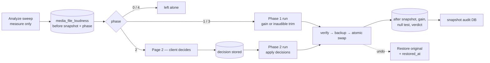

# LUFS Loudness Normalization — How It Works

A map of the loudness (LUFS) normalization subsystem: what it measures, what it
decides, what it writes to disk, and how it can be undone. Written from the code
as it stands on branch `download_damage_lufs`.

- **Goal:** bring every song in the library to a fixed integrated loudness
  (default **−12.6 LUFS**) without altering anything else about the file.
- **Non-goal:** it is *not* ReplayGain. ReplayGain leaves the file alone and asks
  the player to change the level. This rewrites the audio file in place.
- **Safety model:** every rewrite is verified after the fact, and (by default) the
  untouched original is copied outside the library first so the whole thing is
  reversible.

---

## 1. Component map

| Layer | Path | Responsibility |
|---|---|---|
| ffmpeg wrappers | `core/ffmpeg/loudnorm.go` | Measure loudness (`loudnorm` as analyser only) |
| | `core/ffmpeg/loudnorm_apply.go` | Apply a decided transform (gain ± limiter) |
| | `core/ffmpeg/loudnorm_encoder.go` | Pin the output format to the source |
| | `core/ffmpeg/loudnorm_backup.go` | Store / find / restore untouched originals |
| | `core/ffmpeg/loudnorm_timeout.go` | Bound every ffmpeg invocation |
| | `core/ffmpeg/audit_probe.go` | `ffprobe` snapshot + null test |
| Engine | `core/loudness/plan.go` | Phase classification + transform selection |
| | `core/loudness/optimize.go` | Encode → verify → accept/reject → swap |
| | `core/loudness/audit.go` | Build the before/after record, verdicts |
| | `core/loudness/restore.go` | Put the original back, rewrite the record |
| | `core/loudness/settings.go` | UI-stored on/off toggles |
| Model | `model/loudness_audit.go` | `LoudnessAudit`, statuses, verdicts, actions |
| Persistence | `persistence/loudness_audit_repository.go` | Upsert / get / clear |
| | `persistence/loudness_audit_snapshot.go` | Copy the audit table to its own SQLite file |
| | `persistence/mediafile_repository.go` | LEFT JOIN + all list filters/sorts |
| HTTP | `server/nativeapi/song_loudness*.go` | Jobs, status, decisions, backups, snapshots |
| UI | `ui/src/lufs/` | Page 1 — the whole library, results and reports |
| | `ui/src/lufs2/` | Page 2 — the exceptions / decision queue |

Routes are mounted **admin-only** (`native_api.go` → `adminOnlyMiddleware`).

---

## 2. Data model

`media_file_loudness` is a **separate table**, keyed 1:1 on `media_file_id` with
`ON DELETE CASCADE`. It lives apart from `media_file` on purpose: a rescan
rebuilds `media_file` from the files on disk, which would erase the "before"
snapshot — and once the original has been overwritten and its backup deleted,
that snapshot is unrecoverable.

Migrations, in order:

| Migration | Adds |
|---|---|
| `20260727020000_add_media_file_loudness` | base table, before-snapshot, verdict/status/action |
| `20260727040000_add_loudness_phase` | `phase`, `decision` |
| `20260727060000_add_loudness_after_snapshot` | `*_after` columns (same probe as before) |
| `20260731120000_add_loudness_was_exception` | `was_exception` latch + backfill |
| `20260731190000_fix_loudness_was_exception_latch` | recompute latch (drops `refused` as a trigger) |
| `20260804090000_add_loudness_restored_at` | `restored_at`, so sweeps leave restored songs alone |

### Column groups

- **Before snapshot** — `lufs_before`, `tp_before`, `lra_before`, `codec/bitrate/
  sample_rate/bit_depth/channels/duration/size/art_before`. This is what the song
  *was*.
- **After snapshot** — same fields with `_after`, measured with the *same probe*
  so the comparison is like-for-like (the earlier version read them from
  `media_file`, whose extractor reports a slightly different duration and made
  every rewrite look like it shifted the track).
- **Judgement** — `status`, `verdict`, `action`, `phase`, `decision`,
  `null_residual`, `gain_applied`, `error`.
- **History flags** — `has_backup`, `was_exception` (latch, never lowered),
  `restored_at` (not a latch — a fresh analysis clears it).

### Enumerations

```
status   : analyzed | processed | failed
verdict  : untouched | safe | dynamics_changed | rewrite_costly | reencoded | failed
action   : gain | limited | skipped | refused
decision : "" (pending) | limit | gain_ceiling | skip
phase    : -1 unplanned | 0 done | 1 gain | 2 review | 3 trim | 4 close-enough
```

`phase = 2` is duplicated as `model.LoudnessPhaseReview` because `core/loudness`
imports `model`, not the other way round; a compile-time assertion in `plan.go`
fails the build if they drift.

---

## 3. Measurement

```
Measure(path) = ffprobe container/stream snapshot
              + ffmpeg -af loudnorm=I=..:TP=..:LRA=..:print_format=json -f null -
```

`loudnorm` is used **purely as an analyser** — it reports `input_i` (integrated
LUFS), `input_tp` (true peak), `input_lra` (loudness range) and never touches
the audio. Nothing about the transform is left to ffmpeg's judgement.

The JSON is extracted by scanning backwards from the last `"input_i"` to the
enclosing `{` and brace-matching forward, so ffmpeg's log noise before it is
harmless.

Every invocation is bounded: `DecodeTimeout(duration) = 2 min + 1 s per second of
audio`, capped at 2 h; a probe gets 2 min; an unknown duration gets 30 min. A
timeout is reported distinctly from a cancellation.

---

## 4. The planner — `PlanFor`

Everything rests on one fact: **a constant gain moves the integrated loudness and
the true peak by exactly the same amount.** So the peak after correction is known
before the file is opened.

```
GainToTarget    = target − lufs
PredictedPeak   = truePeak + GainToTarget
PeakOverBy      = max(0, PredictedPeak − ceiling)
TransparentGain = ceiling − truePeak          # largest gain that keeps peaks legal
LoudnessAtCeiling = lufs + TransparentGain
Shortfall       = max(0, target − LoudnessAtCeiling)
RewriteCost     = f(bitrate)                  # loudness lost just by re-encoding
SafeGain        = min(GainToTarget + RewriteCost, TransparentGain)
                  # ...relaxed to the fallback ceiling only if that misses target
```

`PLR` (peak-to-loudness ratio) is carried for display but is *not* an independent
input — `PeakOverBy = PLR + target − ceiling` exactly, so the fixed thresholds are
already dynamics-aware.

### Phase decision

```mermaid
flowchart TD
    A[measure lufs, truePeak] --> B{|lufs − target| ≤ tolerance?}
    B -- yes --> P0[Phase 0 DONE — file never opened]
    B -- no --> C{|SafeLoudness − target| ≤ tolerance?}
    C -- yes --> P1[Phase 1 GAIN — constant gain, automatic]
    C -- no --> D{PeakOverBy ≤ 3.0 dB?}
    D -- yes --> P3[Phase 3 TRIM — inaudible peak cut, automatic]
    D -- no --> E{|lufs − target| ≤ 0.5 dB?}
    E -- yes --> P4[Phase 4 CLOSE ENOUGH — left alone, not listed]
    E -- no --> P2[Phase 2 REVIEW — client decides]
```

Calibration constants (all in `plan.go` / `optimize.go`, each with the measurement
that produced it in the comment):

| Constant | Value | Meaning |
|---|---|---|
| `tolerance` | 0.2 LU | the target is a band, not a point |
| `leaveAloneToleranceDB` | 0.5 dB | below this, not worth asking a human |
| `audibleShaveDB` | 3.0 dB | deeper peak cuts stop being inaudible |
| `minWorthwhileGainDB` | 0.1 dB | smaller gains sit inside the process's own noise |
| `truePeakToleranceDB` | 0.1 dB | acceptance slack on the ceiling |
| `maxDriftCorrectionDB` | 1.5 dB | refuse to feed back a wild measurement |
| `fallbackCeilingDB` | −0.1 dBTP | last resort when the configured ceiling is unreachable |
| `RewriteLoudnessCost` | 0.46 / 0.26 / 0 dB | ≤160k / ≤224k / above |
| `limiterHeadroom` | 1.0 / 0.6 / 0.3 dB | how far under the ceiling the limiter aims |

### `SpecFor` — plan + decision → transform

A recorded decision **outranks** the plan (a person overruling the engine),
except that `PhaseDone` short-circuits first — "limit to target" on a song already
at target is a re-encode that buys nothing.

| Input | Transform |
|---|---|
| `PhaseDone` | none |
| decision `limit` | `volume=GainToTarget` + true-peak limiter at the ceiling → lands on target |
| decision `gain_ceiling` | `volume=TransparentGain`, nothing reshaped → lands short |
| decision `skip` | none |
| `PhaseGain` | `volume=SafeGain` |
| `PhaseTrim` | same as `limit`, applied without asking |
| anything else | none |

Pure-gain transforms below `minWorthwhileGainDB` are dropped entirely.

---

## 5. Applying — `ffmpeg.Apply`

```
ffmpeg -nostdin -hide_banner -y -i IN
       -map 0:a:0 -map_metadata 0 -map_chapters 0
       [-map 0:v:0 -c:v copy -disposition:v:0 attached_pic | -vn]
       -af "volume=<G>dB[,aresample=<4x>,alimiter=limit=..,aresample=<src>]"
       -c:a <encoder pinned to source> [-b:a Nk] [-sample_fmt ..] -ar .. -ac ..
       -metadata replaygain_*=  (cleared)
       OUT
```

Key points:

- **Format is pinned to the source**, never left to ffmpeg's defaults — that is how
  320 kbps sources previously ended up at 128 kbps and 44.1 kHz at 48 kHz. An
  unknown codec is a hard error rather than a guess.
- Lossy bitrates are **rounded up** to the next standard rung (never down), and
  clamped to the format's ceiling (`MaxBitrateFor("mp3") = 320`).
- **Cover art must be both mapped and marked** `attached_pic`, or the muxer drops
  it — that was the artwork-destroying bug.
- **Stale ReplayGain tags are cleared** on the way out, or an RG-enabled player
  would undo the normalization.
- The **true-peak limiter runs on an upsampled signal** (4×, capped at 192 kHz),
  because `alimiter` only sees sample values and inter-sample peaks are invisible
  at the source rate.
- The limiter aims **below** the ceiling by `limiterHeadroom(bitrate)`, because the
  peak springs back when the waveform is re-encoded.

---

## 6. The optimize loop — `loudness.Optimize`

```mermaid
sequenceDiagram
    participant J as job worker
    participant O as Optimize
    participant F as ffmpeg
    participant D as disk

    J->>O: track, decision, options
    O->>O: filelock.Lock(path)
    O->>F: Measure(track)          %% before
    O->>O: PlanFor(...) → SpecFor(...)
    loop up to 3 attempts
        O->>F: Apply(track → temp)
        O->>F: Measure(temp)       %% after
        O->>O: IntegrityIssues(before, after)?
        O->>O: loudnessOK? peakOK?
        alt both OK
            O->>O: accept
        else only ceiling missed
            O->>O: keep as fallback candidate (lowest peak wins)
        end
        O->>O: feed measured miss back into gain / limiter ceiling
    end
    opt nothing accepted but a fallback exists
        O->>O: accept it, CeilingRelaxed = true
    end
    O->>D: BackupOriginal(track)   %% only if enabled; never overwrites
    O->>D: chmod + os.Rename(temp → track)  %% atomic
```

Acceptance requires **two** things: the file lands where the transform intended
(target normally, deliberately short for `gain_ceiling`), *and* its peaks respect
the ceiling. Loudness alone is not enough — hitting −12.6 by pushing peaks past
the limit is not what was asked for.

Anything short of that is deleted and **the original is left exactly as it was**.
A rejection is recorded as `action = 'refused'` with the reason in `error`, so the
next sweep does not rebuild the same rejected file; a fresh analysis clears it.

Failure ordering is deliberate: the encode is written to a temp file in the same
directory, the backup is taken *before* the rename, and the rename is the last
step. A crash or a killed ffmpeg leaves the library file untouched.

---

## 7. The audit — what was actually done to the file

Three entry points:

| Function | Used by | Cost |
|---|---|---|
| `Audit` | full analysis sweep | measure file + measure backup + null test |
| `MeasureOriginal` | "original loudness only" sweep | one measure (falls back to `Audit` if a backup exists) |
| `AuditFromOptimize` | after a run | reuses the run's two measurements; only the null test is new |

`AuditFromOptimize` may only reuse the run's own before-measurement when *this
run stored the original* (`BackupCreated`) or when backups are off
(`BackupSkipped`). An existing backup is never overwritten, so on a second pass
the stored original predates the run and the "before" must be read from the
backup itself.

### Null test — `ffmpeg.NullResidual`

```
[0:a] resample 44.1k, fltp, stereo               → a   (the stored original)
[1:a] volume=−gain, resample 44.1k, fltp, stereo → b   (the finished file, un-gained)
[a][b] amerge, pan=mono|c0=c0-c2, astats         → RMS level dB of (a − b)
```

It measures the **energy** of the leftover, not its peak: gain-only rewrites peak
around −14 dB but sit near −45 by energy, while genuinely reshaped audio sits near
−10 by energy. By peak the two are indistinguishable; by energy they are 30 dB
apart.

Thresholds scale with bitrate, because the codec noise floor does:

| Source | Floor |
|---|---|
| lossless | −60 dB |
| ≤160 kbps (or unknown) | −25 dB |
| 161–256 kbps | −30 dB |
| >256 kbps | −35 dB |

> These are marked **PROVISIONAL** in the source. `cmd/measure-null-floor` exists to
> replace them with figures measured on the actual library.

### `inferAction` — gain or something more?

Only direct evidence decides:

- LRA closed by > 0.5 dB → `limited` (a level change cannot narrow the range)
- Peak fell **below** what the gain predicts by > 0.5 dB → `limited`
- Peak fell by > 0.15 dB **and** the null test says a great deal changed → `limited`
- otherwise → `gain`

The peak is read in one direction only: a peak *higher* than predicted is the
encoder rebuilding the waveform, not limiting.

### `verdict` — was the file harmed?

```
IntegrityIssues (codec / bitrate / rate / depth / channels / duration / art) → reencoded
action == limited, or LRA moved > 0.5                                        → dynamics_changed
null residual above its floor                                                → rewrite_costly
otherwise                                                                    → safe
```

`rewrite_costly` is deliberately separate from `dynamics_changed`: the null test
measures *how much* of the file differs, never *what* about it differs. Routing a
large leftover into the dynamics verdict accused tracks of having their peaks
trimmed when nothing had trimmed them.

`bitrateLost` exempts lossless (turning a track down makes it compress better —
620 → 592 kbps with nothing lost) and exempts a lossy file that came back at the
format's ceiling.

**Outcome** — "did the song end up where the client asked?" — is a *different*
question from the verdict, and is derived, not stored (`ui/src/lufs/outcome.js`
mirrored by `LoudnessOutcomeFilter` in Go): `on_target`, `level_two`,
`short_by_choice`, `short_source_limited`, `not_attempted`.

---

## 8. Backups and restore

```
<BackupFolder or dirname(library)>/original_backup before normalisation/<id[:2]>/<id>__<filename>
```

- Keyed by **song id, not path** — a song can be moved or renamed without losing its
  original, and two songs can never claim the same slot. (Previously a new song
  arriving at a deleted song's path inherited its backup and restore handed back
  the wrong recording. `LegacyLoudnessBackupPath` still *reads* the old layout.)
- Stored **outside the music library**, so a cleanup or reorganisation of the
  library cannot take the backups with it.
- Copies are **atomic**: temp file in the same dir → `fsync` → `chmod` → `rename`.
  "The file exists" is treated as "the original is safe", so a half-written file at
  that path would be trusted and the real audio lost.
- An existing backup is **never** overwritten.

**Restore** (`core/loudness/restore.go`):

1. Find the backup; refuse if there is none.
2. `verifyStoredOriginal` — probe it as audio, then check size / duration / codec
   against the recorded before-snapshot. Nothing is overwritten on the strength of
   an unchecked file.
3. Copy it back (the backup is *kept*, so a song can be restored again).
4. Rebuild the audit: the before-snapshot is carried over untouched (it describes
   the file now on disk); the after-snapshot, gain, null test and verdict are all
   dropped. Stamp `restored_at`.
5. Clear the decision, update the LUFS tag, and refresh the song's stored audio
   properties (`UpdateAudioProperties`) so the library agrees with the disk.

**Orphan cleanup** (`song_loudness_backups.go`) walks every backup root, matches
each file to a live song by id (or by legacy path), and *moves* orphans into a
hidden `.orphaned-<timestamp>/` folder — never deletes. It refuses entirely if the
library reads as empty, or if *every* backup looks orphaned (the signature of a
library that moved).

---

## 9. Jobs, concurrency and the HTTP surface

Three background jobs, each with `running/stopping/total/processed/inFlight/
cancelled` counters, a stop channel, and a cancellable context:

| Job | Started by | Writes files? |
|---|---|---|
| `libraryLoudness` | "Optimise all LUFS" toggle, `POST /library`, or a selection `PUT /song/loudness` | yes |
| `loudnessAnalyze` | `POST /analyze` (`all` or `ids`, mode `original` or full) | no |
| `restoreLoudness` | `POST /restore` | yes |

**Only one may run at a time.** `claimLoudnessFileWork` (`song_loudness_guard.go`)
is a single mutex-guarded claim; a check under one mutex and a set under another
is not a claim. Analysis is included even though it never writes a library file:
it *publishes a claim about what is on disk*, and a restore in between would leave
the record describing audio that no longer exists.

**Stopping** sets `stopping`, closes the stop channel (no more tracks handed out),
then after a 10 s grace period cancels the context, killing in-flight ffmpeg
processes. Killing is safe — the encode is a temp file and the library file is only
touched by the final rename — so an abandoned track is counted as `cancelled`, not
`failed`.

Records are written with `context.WithoutCancel`: past the rename, the file on
disk has already changed, so losing the record would be the one inconsistency the
audit exists to prevent.

### Endpoints (all admin-only, under `/api`)

```
PUT    /song/loudness                    optimise a selection (background)
POST   /song/loudness/library[?phase=2]  whole-library run / apply decisions
GET    /song/loudness/library            status
POST   /song/loudness/library/stop
POST   /song/loudness/analyze            measure-only sweep
GET    /song/loudness/analyze            status
POST   /song/loudness/analyze/stop
DELETE /song/loudness/analyze/results    clear ALL audit rows
POST   /song/loudness/restore            restore originals (background)
GET    /song/loudness/restore            status
POST   /song/loudness/restore/stop
PUT    /song/loudness/decision           record limit | gain_ceiling | skip
GET    /song/loudness/settings           target, tolerance, ceiling, toggles
PUT    /song/loudness/settings           enabled / backup toggles
GET    /song/loudness/summary            library counts
GET    /song/loudness/backups            orphan report
POST   /song/loudness/backups/cleanup    move orphans aside
GET    /song/loudness/db                 list audit snapshots
POST   /song/loudness/db                 take a snapshot
POST   /song/loudness/db/restore         restore a snapshot
GET    /song/download                    zip a selection (≤500, JWT in query)
```

### Which tracks a run selects — `loudnessRunFilter`

The selection lives in SQL, not Go: the engine's first act is a full decode, so
handing it everything means re-measuring the whole library on every run.

An **explicit id list overrides every clause** — those guards exist to stop a sweep
redoing its own work, and applying them would drop the very tracks a person picked
out. Otherwise:

- **Phase 1 sweep:** not missing, `restored_at is null`, phase ∉ {2, 4}, not
  (phase 0 with a measurement), `action <> 'refused'`. Tracks never analysed
  (`phase = -1`, or no row at all → coalesced to −1) are included.
- **Phase 2 run:** not missing, `restored_at is null`, `decision ∈ {limit,
  gain_ceiling}`. The **decision** is the gate, not the phase — requiring `phase = 2`
  as well meant "apply decisions" selected zero songs and reported success.

---

## 10. Persistence, filters and the summary

`selectMediaFile` and `CountAll` both `LEFT JOIN media_file_loudness`, and all
audit columns are exposed as `loudness_*` aliases plus sort keys.

Filters are **defined once in Go and reused by both the list and the summary**, so
the headline can never disagree with the table you click into:

- `LoudnessOutcomeFilter` — on_target / short / not_measured
- `LoudnessExceptionFilter` — the songs a person still has to act on
- `LoudnessLevelTwoFilter` — defined as *the complement* of the exception filter
  within the 0.2–0.5 dB band, because enumerating the ways in missed one
- `loudnessReasonFilter` — why a song is on the exceptions page
  (`peak_over`, `format_changed`, `missed_target`, `peaks_trimmed`, `needs_trade`),
  matched by the opening words of the strings `rejection()` writes. Fails safe: an
  unlisted shape matches no category rather than the wrong one.
- `loudness_verdict` special-cases the UI-only value `left_as_is` → `action = refused`.

`Put` is an upsert with two deliberate omissions on the UPDATE path: **`decision`
is never overwritten** (re-analysing must not discard a client's choice), and
**`was_exception` is only ever written when true** (it is a latch).

### Audit snapshots

The audit lives in the main DB, so it goes when the data directory goes. After
every finished job (and on demand) the table is copied — joined with `song_path`
and `song_title` so the file stands on its own — into its own SQLite database
under `AuditDbFolder`, defaulting to `.lufs-db/` beside the backups. `ATTACH` runs
on a dedicated connection (it belongs to a connection, not to the pool). Written
to a dot-prefixed temp name and renamed. `AuditDbKeep` (default 10) prunes the
oldest; 0 keeps everything. Restore is an **exact replace** of
`media_file_loudness` only, using whatever columns the two schemas share.

---

## 11. The UI

**Page 1 — `lufs`** (`/lufs`, sidebar): the whole library as a table over
`/api/song`, with the audit joined in.

- `LufsSummary` — the headline counts from `/summary`
- `LufsToggle` — starts/shows a whole-library run (it reflects the *job*, not a
  stored preference, so it cannot claim work the server is not doing)
- `BackupToggle`, `LufsAnalyzeButton`, `LufsJobButtons`, `JobProgress`,
  `RestoreOriginalButton`, `BackupCleanupButton`, `AuditDbButtons`,
  `DownloadSongsButton`
- Fields: before/after pairs for LUFS, true peak, LRA, codec, bitrate, rate, depth,
  channels, duration, art; gain; null residual; verdict; **outcome**; status;
  action; `ReportField` (a per-song plain-English report from `report.js`)

**Page 2 — `lufs2`** (`/lufs2`, hidden from the sidebar, reached from page 1): the
decision queue. `recommendation.js` recomputes the same arithmetic client-side
(including a **peak spring-back allowance** the engine does not model) and
`optionsFor` shows what each of the three decisions would cost. `reason.js` turns
engine rejection strings into sentences, always ending with *"Your original file
is untouched."*

`useJobStatus` keeps **one shared polling record per job URL** — every component
watching a job reads the same store, which is why starting a run from a toolbar
now updates the progress bar elsewhere on the page.

---

## 12. Configuration

```toml
[Scanner.LoudnessNormalization]
Enabled       = false     # also a UI toggle; the UI value wins once used
TargetLUFS    = -12.6
TruePeak      = -0.5      # dBTP ceiling
LRA           = 11.0      # passed to loudnorm; not used in any decision
Tolerance     = 0.2       # LU; <= 0 falls back to 0.2
Parallelism   = <NumCPU>
Backup        = true      # also a UI toggle
BackupFolder  = ""        # default: next to the library root
AuditDbFolder = ""        # default: <backup root>/.lufs-db
AuditDbKeep   = 10        # 0 or less = keep everything
```

`Enabled` and `Backup` are stored in the `property` table once toggled from the
UI; until then the config file is followed, so config reloads are picked up.
`Backup` cannot be changed while a run is going.

---

## 13. End-to-end flow



The scanner deliberately does **not** measure or change loudness (`scanner/
phase_1_folders.go`) — it is slow, and rewriting files as a side effect of a scan
is not something anyone asked for.
